<p align="center">
  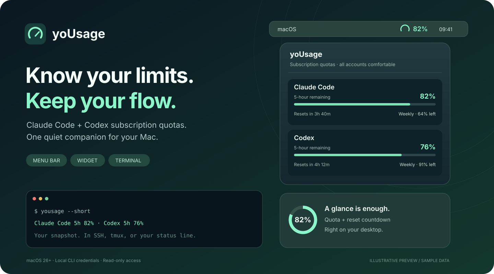
</p>

<h1 align="center">yoUsage</h1>
<p align="center"><strong>한도는 한눈에. 작업은 끊김 없이.</strong></p>
<p align="center">Claude Code · Codex 구독의 남은 한도와 리셋 시간을 보여주는 macOS 유틸리티.</p>
<p align="center">
  <a href="#빠른-시작">빠른 시작</a> ·
  <a href="#터미널에서도">터미널 연동</a> ·
  <a href="docs/GUIDE.ko.md">상세 가이드</a>
</p>

> 위 이미지는 기능을 설명하기 위한 일러스트이며, 수치는 예시입니다. **구독 계정 한도**를 추적하며 API 종량제 비용은 지원하지 않습니다.

## 작업 흐름에 맞춰, 세 곳에서

| 메뉴바 | 바탕화면 위젯 | 터미널 |
| :--- | :--- | :--- |
| 잔량 게이지와 퍼센트를 바로 확인 | 선택한 계정의 한도와 리셋 타이머 | SSH · tmux · zellij에서도 확인 |
| 팝오버에서 여러 계정을 함께 조회 | 앱이 저장한 스냅샷으로 표시 | 상세 보기 · 한 줄 요약 · JSON 출력 |

- **Claude Code + Codex** — 5시간·주간 한도를 함께 확인하고, Claude가 제공하는 모델별 주간 한도도 표시합니다.
- **개인·업무 계정을 한곳에** — CLI 설정 폴더별로 계정을 연결하고 메뉴바·위젯에 표시할 계정을 선택합니다.
- **내 기준에 맞는 경고** — 남은 양 / 사용한 양 전환과 주의·위험 색상 기준을 지원합니다. 기본값은 잔량 표시입니다.
- **기존 CLI 로그인 활용** — 별도 로그인 화면 없이 로컬 인증 정보를 읽습니다. 토큰을 갱신하거나 별도로 저장하지 않습니다.

## 메뉴바에서 잔량과 경고를 바로 확인

메뉴바의 숫자와 팝오버의 막대는 기본적으로 **남은 양**을 보여줍니다. 잔량이 줄어들면 주의·위험 색상으로 전환됩니다.

<p align="center">
  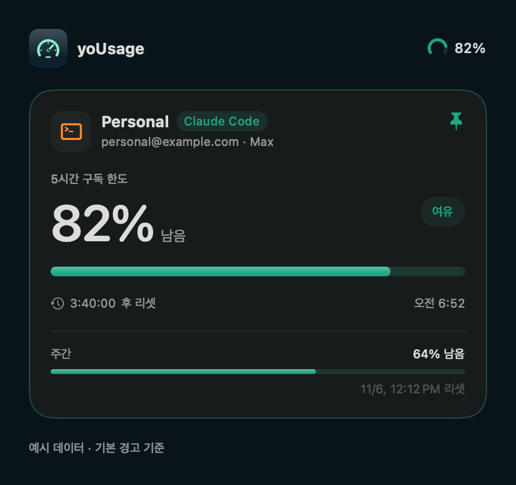
</p>

예시 데이터를 실제 화면 코드로 렌더링한 GIF입니다. 변화 속도는 설명을 위해 압축했으며, 실제 사용량은 기본 3분 주기의 조회 또는 수동 새로고침 시 반영됩니다. 기본 기준은 **잔량 40% 이하에서 주의, 15% 이하에서 위험**입니다.

<details>
<summary>움직임 없이 정지 이미지로 보기</summary>

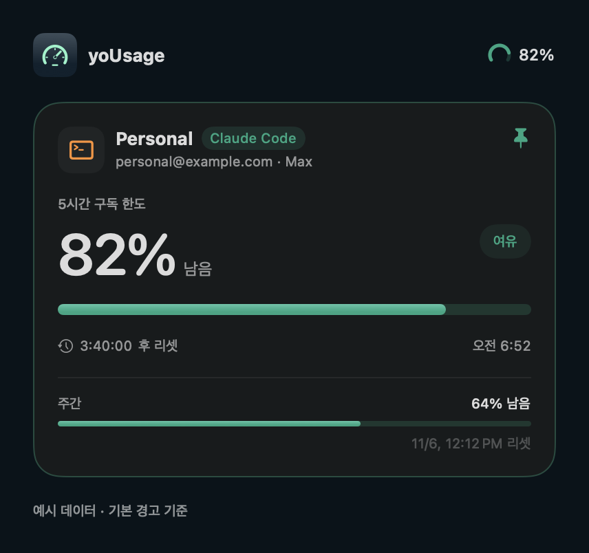

</details>

## 위젯은 필요한 정보만

<p align="center">
  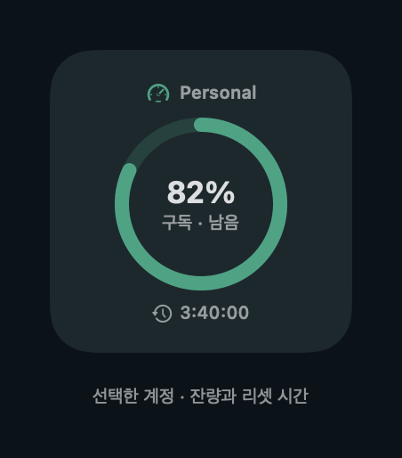
</p>

선택한 계정의 이름·잔량·리셋 시간을 바탕화면에서 확인합니다. 위 이미지는 **실제 위젯 뷰를 예시 데이터로 렌더링**한 것으로, macOS 바탕화면을 캡처한 화면은 아닙니다.

## 빠른 시작

**macOS 26+ · Xcode 26+ · [XcodeGen](https://github.com/yonaskolb/XcodeGen)**이 필요합니다. 소스에서 직접 빌드합니다.

```sh
git clone https://github.com/newbission/yousage.git
cd yousage
brew install xcodegen
xcodegen generate
open yoUsage.xcodeproj
```

1. Xcode에서 **yoUsage** 스킴을 선택하고 **⌘R**로 실행합니다.
2. 이 Mac의 Claude Code 또는 Codex CLI에 로그인되어 있으면 기본 설정 폴더의 계정이 자동으로 등록됩니다.
3. 메뉴바 게이지를 눌러 한도와 리셋 시간을 확인합니다.

위젯은 앱을 한 번 실행한 뒤 **바탕화면 우클릭 → 위젯 편집 → yoUsage**에서 추가하세요. 기본 조회 주기는 3분이며 수동 새로고침도 지원합니다.

<details>
<summary>터미널에서 앱 빌드·실행</summary>

```sh
xcodebuild -project yoUsage.xcodeproj -scheme yoUsage -derivedDataPath build build
open build/Build/Products/Debug/yoUsage.app
```

기본값은 Apple 계정 없이 실행 가능한 ad-hoc 서명입니다. 서명과 위젯 데이터 공유 설정은 [상세 가이드](docs/GUIDE.ko.md#서명과-app-group)를 참고하세요.

</details>

## 설정도 화면으로 확인하세요

메뉴바 팝오버 오른쪽 위 **톱니바퀴**를 누르면 설정이 열립니다.

<p align="center">
  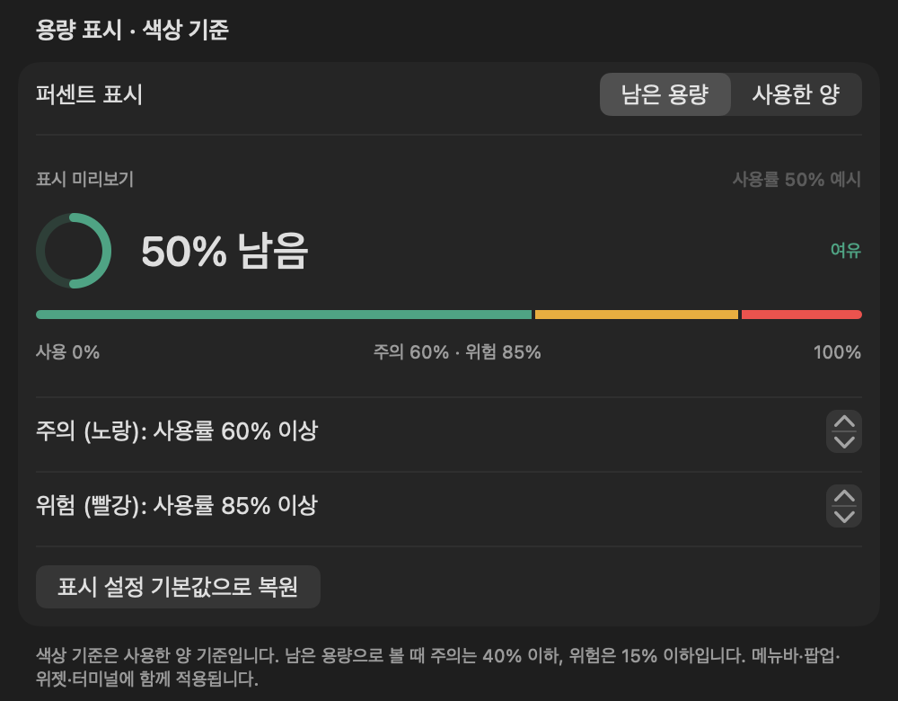
</p>

- **퍼센트 표시** — ‘남은 용량’과 ‘사용한 양’을 전환합니다.
- **색상 기준** — 주의·위험 기준을 1% 단위로 조절하고 미리보기로 확인합니다. 기준 수치는 항상 **사용률**입니다.
- **함께 적용** — 표시 방식과 기준은 메뉴바·팝오버·위젯·터미널에 함께 적용됩니다.

<details>
<summary>설정 전체 화면 보기 — 자동 시작·계정·폴링 주기 포함</summary>

<p align="center">
  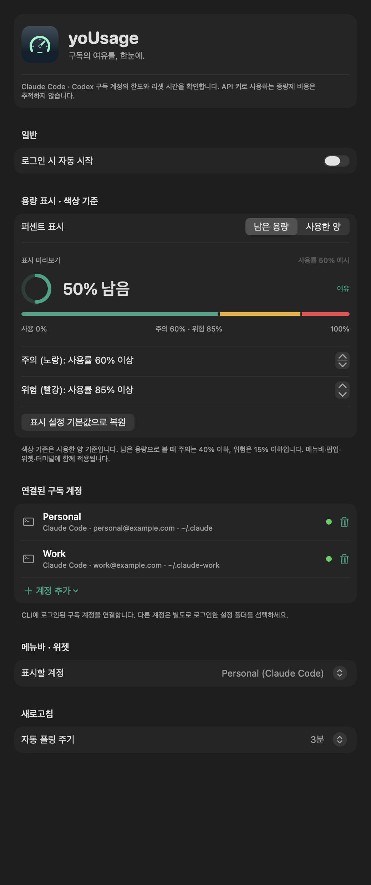
</p>

실제 `SettingsView`를 예시 계정으로 렌더링했습니다. 전체 항목을 한 번에 볼 수 있도록 문서용 캔버스 높이만 늘렸습니다. 앱에서는 스크롤해서 확인합니다.

</details>

## 터미널에서도

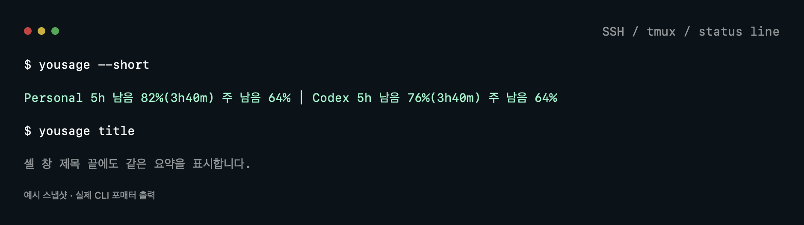


메뉴바 앱이 저장한 스냅샷을 읽으므로 SSH 세션에서도 사용할 수 있습니다. **최신 값을 받으려면 해당 Mac에서 앱이 실행 중이어야 합니다.** 15분 이상 지난 스냅샷에는 경고가 표시됩니다.

```sh
# Release 빌드 후 PATH에 연결
xcodebuild -project yoUsage.xcodeproj -target yoUsageCLI \
  -configuration Release SYMROOT="$PWD/build/release" build
mkdir -p ~/.local/bin
ln -sf "$PWD/build/release/Release/yousage" ~/.local/bin/yousage
# ~/.local/bin이 PATH에 포함되어 있어야 합니다.

yousage             # 계정별 한도와 리셋 시간
yousage --short     # 한 줄 요약
yousage --json      # 스냅샷 원본
yousage title       # 셸 창 제목 끝에 사용량 표시
```

Claude Code 입력창 아래에도 잔량을 표시할 수 있습니다. `~/.claude/settings.json`의 기존 설정에 다음 항목을 추가하세요.

```json
{
  "statusLine": {
    "type": "command",
    "command": "yousage --short --color"
  }
}
```

[SSH 자동 적용 · tmux · zellij 설정 →](docs/GUIDE.ko.md#터미널-창-제목에-붙이기)

## 여러 계정 연결

<p align="center">
  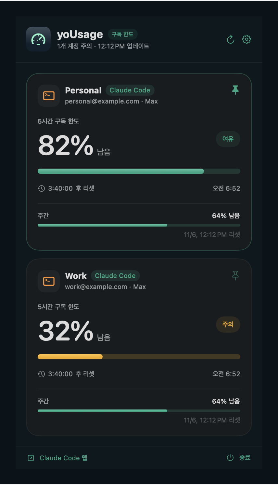
</p>

실제 팝오버를 예시 계정으로 렌더링한 화면입니다. 계정별 잔량·주간 한도·리셋 시간을 비교하고, 핀 버튼으로 메뉴바와 위젯에 표시할 계정을 선택합니다.


### 1. 연결할 계정으로 CLI에 로그인

**기본 계정**은 평소 쓰던 Claude Code에서 `/login`, Codex에서 `codex login`으로 로그인하세요. 기본 폴더의 계정은 yoUsage 첫 실행 시 자동 감지됩니다.

**추가 계정**은 별도의 CLI 설정 폴더에 로그인합니다. 계정 하나가 설정 폴더 하나에 대응합니다.

```sh
# Claude Code: 실행 후 /login
CLAUDE_CONFIG_DIR=~/.claude-work claude

# Codex
CODEX_HOME=~/.codex-work codex login
```

### 2. 설정에서 서비스와 설정 폴더 선택

<p align="center">
  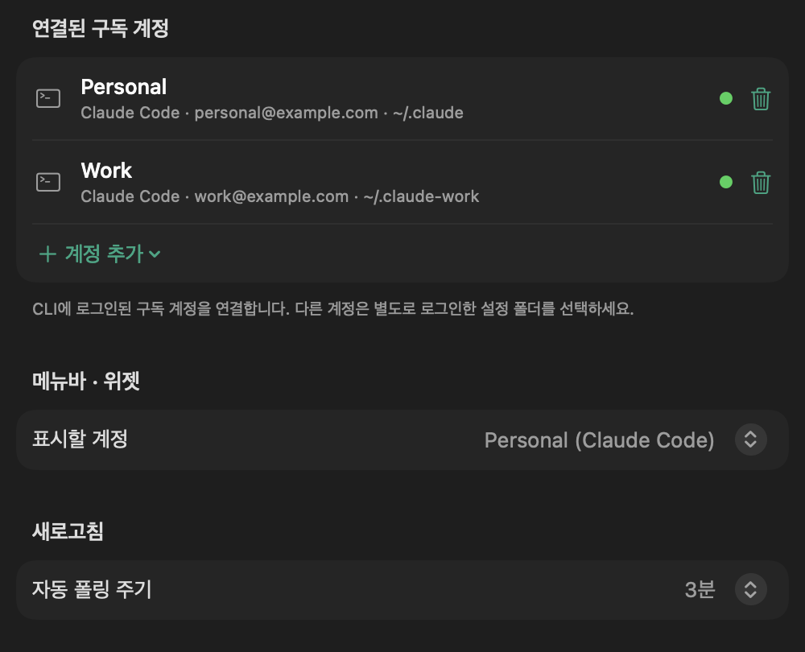
</p>

**설정 → 연결된 구독 계정 → 계정 추가**를 누르면 서비스별로 두 가지 등록 방식이 나옵니다.

| 선택 | 언제 쓰나요? | 등록할 폴더 |
| :--- | :--- | :--- |
| Claude Code → **기본 폴더** | 기본 계정을 수동으로 연결할 때 | `~/.claude` |
| Codex → **기본 폴더** | 기본 계정을 수동으로 연결할 때 | `~/.codex` |
| 각 서비스 → **다른 설정 폴더 선택…** | 개인·업무 등 추가 계정을 연결할 때 | 앞 단계에서 로그인한 `~/.claude-work` 또는 `~/.codex-work` |

폴더 선택 창에서는 **로그인할 때 사용한 설정 폴더 자체**를 선택하고 **추가**를 누르세요. `auth.json` 같은 파일을 선택하는 방식이 아닙니다. 숨김 폴더는 기본으로 표시하며, 보이지 않으면 **⌘⇧.**으로 전환할 수 있습니다. 이미 등록한 서비스·폴더 조합은 중복 추가하지 않습니다.

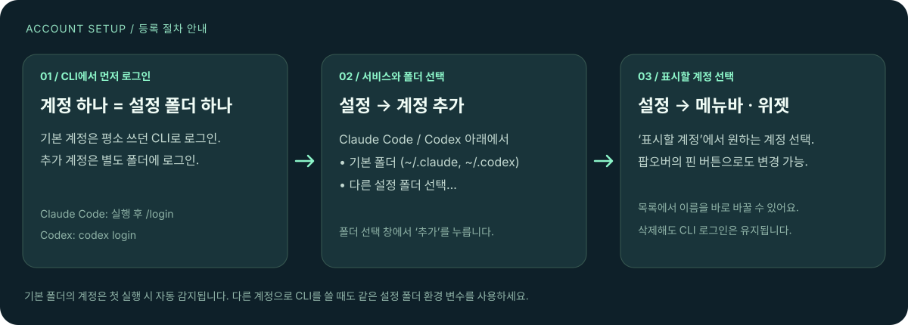

위 설정 이미지는 실제 화면 코드를 예시 계정으로 렌더링한 것이고, 세 단계 이미지는 등록 절차를 정리한 안내도입니다.

### 3. 메뉴바·위젯에 표시할 계정 선택

설정의 **메뉴바 · 위젯 → 표시할 계정**에서 고르거나 팝오버의 **핀 버튼**을 누르세요. 연결된 계정의 이름은 설정 목록에서 바로 수정할 수 있습니다. 휴지통 버튼으로 제거해도 CLI 로그인은 유지됩니다.

다음에 해당 계정으로 CLI를 사용할 때도 같은 환경 변수를 붙여야 합니다.

```sh
CLAUDE_CONFIG_DIR=~/.claude-work claude
CODEX_HOME=~/.codex-work codex
```

## 데이터는 이렇게 흐릅니다

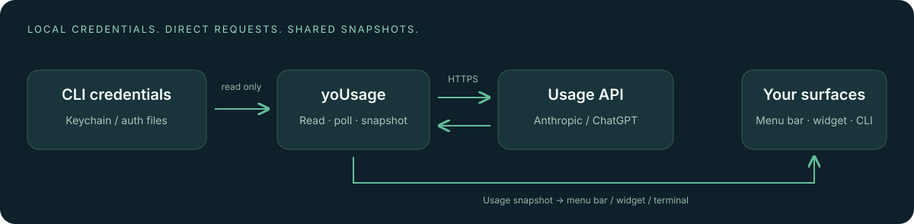

| 서비스 | 인증 정보 | 조회 대상 |
| :--- | :--- | :--- |
| Claude Code | macOS 키체인 및 설정 폴더의 `.credentials.json` | `api.anthropic.com/api/oauth/usage` |
| Codex (ChatGPT) | 설정 폴더의 `auth.json` | `chatgpt.com/backend-api/wham/usage` |

토큰은 해당 서비스에 인증할 때만 사용합니다. 위젯과 CLI는 토큰 대신 사용량 스냅샷을 읽습니다. 두 사용량 API는 **비공개 엔드포인트**이므로 서비스 변경에 따라 연동이 중단될 수 있습니다. 토큰이 만료되면 해당 CLI를 실행해 인증을 갱신하세요.

## 더 알아보기

- [인증·API 응답·로그와 문제 해결](docs/GUIDE.ko.md#사용량을-가져오는-방식)
- [프로젝트 구조](docs/GUIDE.ko.md#프로젝트-구조) · [서명·App Group·샌드박스](docs/GUIDE.ko.md#설정-가이드)
- [Provider 추가](docs/GUIDE.ko.md#provider-추가하기) · [표시 방식과 색상 기준](docs/GUIDE.ko.md#표시-방식과-색상-기준)

문제 진단용 마지막 API 응답은 `~/Library/Logs/yoUsage/`에 저장됩니다. 계정 이메일이 포함될 수 있으니 이슈에 첨부하기 전에 확인하세요.
